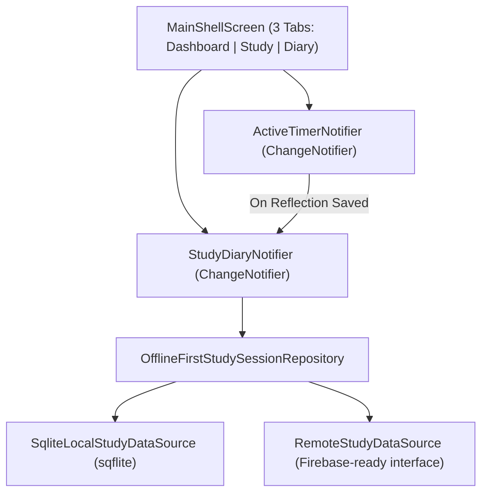

# SPEC: Distraction-Free Study Flow, AI-Ready Reflection & SQLite Core (`study-flow-redesign`)

## 1. Domain Entities and Contracts

### 1.1 Enums (`lib/domain/entities/study_enums.dart`)
- `SessionType`:
  - `pomodoro` — 25 min study + 5 min break per set (configurable target sets, default `4`).
  - `freeStudy` — Open-ended count-up stopwatch (`00:00:00`).
  - `oneHour` — Strict 60-minute (`60:00`) countdown.
- `StudyActivityType`:
  - `topicStudy('Topic Study')`
  - `questionSolving('Question Solving')`
  - `mockExam('Mock Exam')`
- `ReflectionTag` (1-tap signals for future AI guidance):
  - `understoodWell('Understood Well')`
  - `needMorePractice('Need More Practice')`
  - `carelessMistakes('Careless Mistakes')`
  - `timePressure('Time Pressure')`
  - `conceptGap('Concept Gap')`
- `CompanionMood` (Mascot state slot for custom brand character):
  - `idle`, `studying`, `breakRest`, `finalSetCheer`, `proudCelebration`
- `SessionStatus`: `running`, `paused`, `completed`, `abandoned`
- `SyncStatus`: `localOnly`, `pendingSync`, `synced`, `pendingDelete`, `syncFailed`

### 1.2 `StudySession` (`lib/domain/entities/study_session.dart`)
- Properties:
  - `String id` (UUIDv4)
  - `String? userId`
  - `String? subjectId`
  - `String subject` (entered **after** session in Reflection, or via manual log)
  - `String topic`
  - `StudyActivityType activityType` (default `StudyActivityType.topicStudy`)
  - `SessionType sessionType`
  - `SessionStatus status`
  - `DateTime startedAt`
  - `DateTime? endedAt`
  - `int elapsedSeconds` (total active study seconds, excluding breaks)
  - `int pausedSeconds`
  - `int pauseCount`
  - `int completedPomodoroSets` (default `0`)
  - `int? targetPomodoroSets` (for `pomodoro`)
  - `int? targetDurationMinutes` (`60` for `oneHour`, `25 * sets` for `pomodoro`, `null` for `freeStudy`)
  - `int? correctCount`
  - `int? wrongCount`
  - `int? blankCount`
  - `List<ReflectionTag> reflectionTags`
  - `List<String> topicsToReview` ("Topics to look after" for Dashboard & AI Coach)
  - `int? focusRating` (`1..5`)
  - `String notes`
  - `DateTime createdAt`
  - `DateTime updatedAt`
  - `bool isDeleted`
  - `SyncStatus syncStatus`
- Computed AI & YKS Metrics:
  - `int get totalQuestions => (correctCount ?? 0) + (wrongCount ?? 0) + (blankCount ?? 0)`
  - `double? get netScore => totalQuestions == 0 ? null : (correctCount ?? 0) - ((wrongCount ?? 0) * 0.25)`
  - `double? get secondsPerQuestion => totalQuestions == 0 ? null : elapsedSeconds / totalQuestions`

### 1.3 `StudySummary` (`lib/domain/entities/study_session.dart`)
- Aggregates across completed, non-deleted sessions:
  - `int totalSeconds`, `int totalMinutes`, `int todayMinutes`, `int sessionCount`
  - `int totalQuestionsSolved`, `double totalNetScore`
  - `List<String> topicsToReview` (deduplicated list of active topics to look after across sessions)

---

## 2. Dependency and Data Flow

### Pomodoro & Study Flow State Machine (`ActiveTimerNotifier`)
1. **`idle`**: User selects `SessionType` (`pomodoro`, `freeStudy`, `oneHour`). If `pomodoro`, user can adjust `targetSets` (default `4`). **Zero text inputs before starting.**
2. **`studying` (`running` / `paused`)**:
   - `pomodoro`: Counts down `25:00` for current set (`currentSet` of `targetSets`).
   - `freeStudy`: Counts up from `00:00:00`.
   - `oneHour`: Counts down from `60:00`.
3. **`breakTime` (Pomodoro only, `5:00` countdown between sets)**:
   - Triggered automatically when a 25-min Pomodoro set completes and `currentSet < targetSets`.
   - **No note-taking during breaks.**
   - Displays `CompanionMascotWidget` + context-aware psychological message:
     - Standard break (`currentSet < targetSets - 1`): *"It was tiring, right? Take your time and get ready for the next session."*
     - Penultimate break (`currentSet == targetSets - 1`, 1 set left): *"There is one session left, you are doing a great job. Well done!"*
   - User can let the 5-min break finish, tap **Start Next Set Now**, or tap **End Study Early**.
4. **`awaitingReflection` (Post-Session Reflection phase)**:
   - Triggered when `freeStudy` is ended, `oneHour` finishes, or the final Pomodoro set finishes.
   - Shows `CompanionMascotWidget` in `proudCelebration` state: *"I am proud of you! I know that you will see the consequences of your studies."*
   - Presents the fast, AI-ready reflection form:
     1. Subject chips / input & Topic
     2. Activity Type toggle (`Topic Study`, `Question Solving`, `Mock Exam`)
     3. Question counters (`Correct`, `Wrong`, `Blank` -> live `Net` preview) when solving questions
     4. 1-Tap AI feeling tags (`ReflectionTag`) & `"Topics to look after"` chip input
     5. Optional short Notes -> **Save to Diary** (persists to SQLite & resets timer to `idle`).

---

## 3. Atomic Task Checklist

- [x] **Task 1: Dependencies & Domain Layer Upgrade**
  - Update `pubspec.yaml` with `sqflite`, `sqflite_common_ffi`, `path`, `provider`, `shared_preferences`, `intl`, `uuid`.
  - Update `lib/domain/entities/study_enums.dart` and `lib/domain/entities/study_session.dart` with the 3 study modes (`pomodoro`, `freeStudy`, `oneHour`), `StudyActivityType`, `ReflectionTag`, question/Net metrics, and `topicsToReview`.
- [x] **Task 2: SQLite Local Data Source (`sqflite`) & Model Serialization**
  - Update `StudySessionModel` (`toMap` / `fromMap`) for all new AI-reflection & question fields.
  - Implement `lib/data/datasources/sqlite_local_study_data_source.dart` using `sqflite` with indexed `study_sessions` and `study_subjects` tables.
  - Verify repository & SQLite persistence with unit tests (`sqflite_common_ffi`).
- [x] **Task 3: Split State Management (`ActiveTimerNotifier` & `StudyDiaryNotifier`)**
  - Create focused `ActiveTimerNotifier` (handling the 3 study modes, Pomodoro sets/breaks, companion messages, and `awaitingReflection` transition) and `StudyDiaryNotifier` (handling saved sessions, `StudySummary`, and `topicsToReview` management).
  - Provide them via `MultiProvider` in `lib/main.dart`.
- [x] **Task 4: Distraction-Free `StudyScreen` + Companion Break View + Post-Session Reflection Sheet**
  - Rebuild `StudyPageScreen` so starting a session has zero text inputs—just mode selection & timer.
  - Add the Pomodoro break screen with the `CompanionMascotWidget` slot and context-aware encouragement messages.
  - Build the `PostSessionReflectionSheet` (used after finishing a session and when manually logging on the Diary tab).
- [x] **Task 5: 3-Tab Navigation (`DashboardScreen`, `StudyPageScreen`, `DiaryScreen`) & Widget Tests**
  - Update `MainShellScreen` to 3 tabs: **Dashboard** (stats, Net score, "Topics to Look After" review list), **Study** (focus timer), and **Diary** (session history cards with question/Net badges, tags, and `+ Log Past Session`).
  - Update and run widget & unit tests (`flutter analyze --no-fatal-warnings` & `flutter test --no-pub`).

---

## 4. Failure Modes and Edge Cases
- **Finishing a Pomodoro or 1-Hour Session Early:** If the user taps "Finish Study" before the countdown hits `00:00`, as long as `elapsedSeconds > 0`, they still get the supportive completion screen and can log their reflection for the actual time studied.
- **Skipping Reflection ("Discard / Skip Notes"):** If a user wants to save the study time quickly with just a subject (or discard an accidental 2-second timer), provide a clear "Discard Session" button and keep all reflection fields except Subject optional.
- **SQLite Concurrency & Desktop Testing:** Use `sqflite_common_ffi` initialization when running in unit tests or on Linux desktop so the exact same SQL schema runs everywhere.
